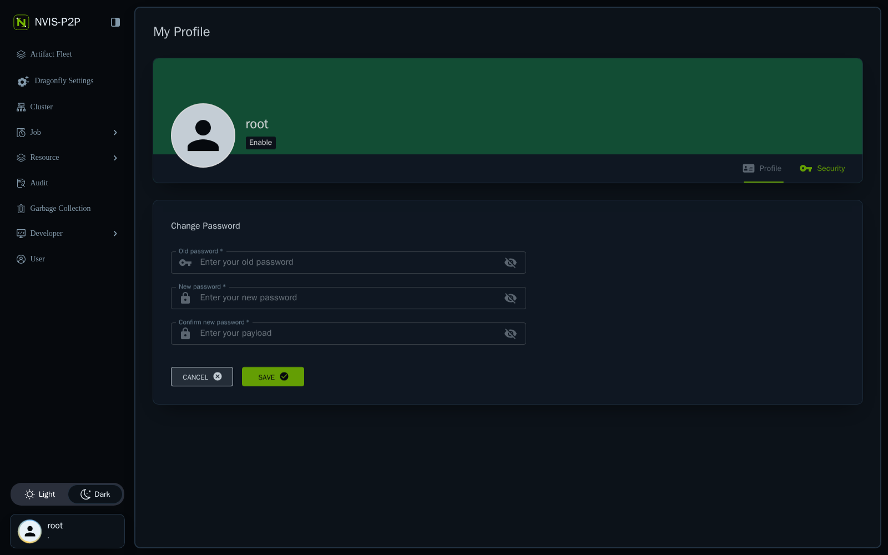
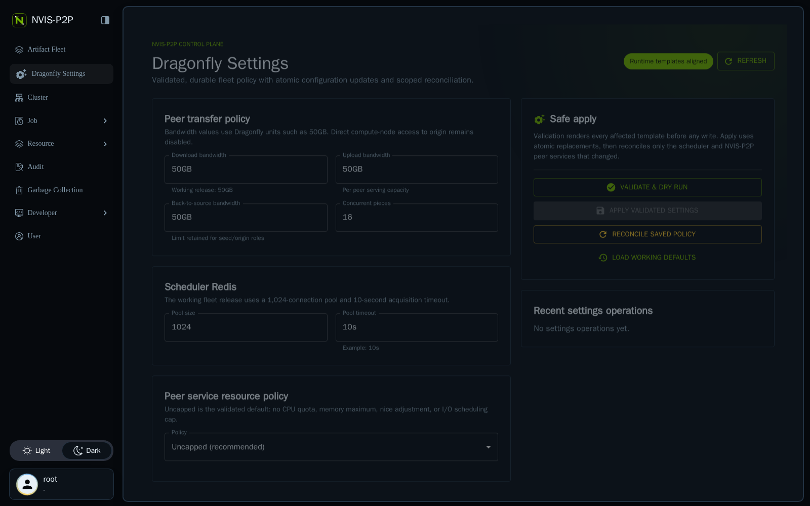
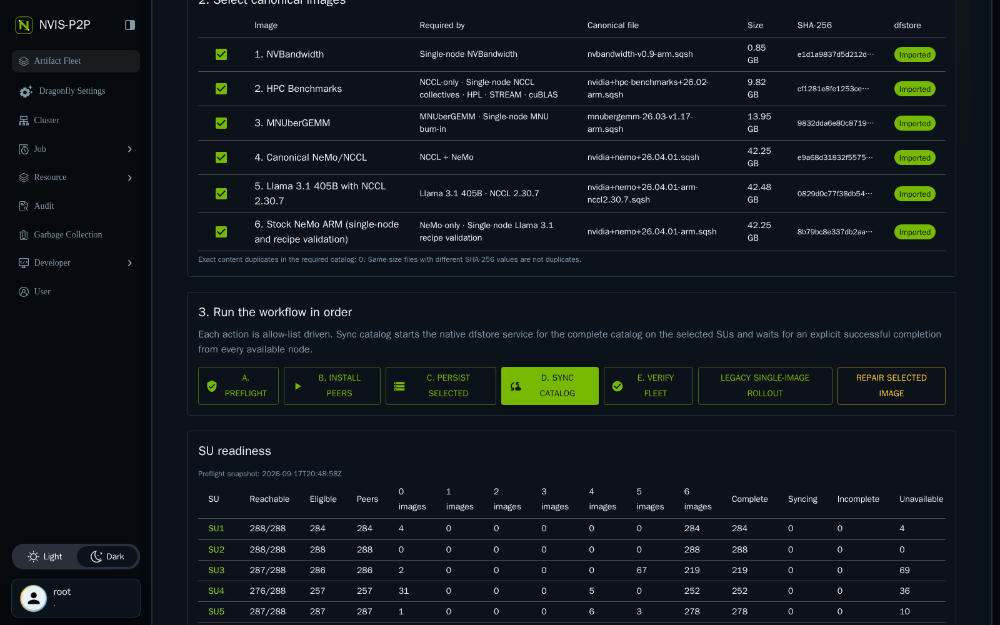

# NVIS-P2P Installation and Deployment Guide

This guide describes a safe installation, configuration, fleet rollout, reconciliation, and rollback of NVIS-P2P. The preferred operator path is the Artifact Fleet console; command examples are for installation and break-glass diagnosis.

## Architecture

NVIS-P2P separates control, durable content, seeds, and compute peers:

```text
/cluster/containers (canonical, read-only origin)
        |
        v
seed origin -> seed peers <-> scheduler/manager/Redis
        |                 \
        |                  -> NVIS console + operations API
        v
dfstore persistent object store
        |
        v
compute dfdaemon peers <-> peer-assisted pieces
        |
        v
/opt/containers/*.sqsh + SHA-256 receipts
```

The app server hosts Manager, scheduler, Redis, two seed peers, canonical origin, S3-compatible object storage, the NVIS web console, and the operations API. Compute nodes run only the client binaries and two systemd units. Compute peers have back-to-source disabled, so origin traffic is concentrated through the seeds rather than multiplied across thousands of nodes.

## Required access and prerequisites

- Linux app server with access to management IP `192.168.10.3` and compute fabric IP `10.41.112.3`.
- Docker Compose for control-plane containers.
- PostgreSQL for Dragonfly Manager and a persistent Redis volume.
- Canonical images in `/cluster/containers` with catalog byte counts and SHA-256 digests.
- Persistent storage for the object store and seed caches.
- Passwordless, non-interactive SSH and the specifically required sudo operations on eligible compute nodes.
- aarch64 compute nodes with a 64 KiB page size and writable `/opt/containers` for the service account.
- Adequate free disk: missing catalog bytes plus the deployment safety reserve.

Do not broaden directory modes or disable SSH host-key checking to satisfy prerequisites. Resolve node-baseline drift explicitly.

## Repository and configuration layout

| Path | Purpose |
|---|---|
| `catalog/images.json` / `images.tsv` | Canonical filenames, byte counts, digests, and use cases |
| `configs/` | Manager, scheduler, seeds, and compute peer configuration |
| `deploy/*/compose.yaml` | Redis, object store, control plane, origin, and console deployments |
| `deploy/systemd/` | App-server and compute-node units |
| `dist/` | Pinned Dragonfly binaries |
| `inventory/` | SU inventories and eligible rosters |
| `scripts/catalog-operation.sh` | Validated console action dispatcher |
| `state/` | Operation logs, persistence receipts, sync run directories, and service state |

## Catalog preparation

For every image, establish the exact canonical filename, byte count, and SHA-256 digest from `/cluster/containers`. Treat the catalog as a release manifest: review changes, do not reuse a filename for different content, and retain prior manifests with the release.

The UI count is dynamic. Adding or removing a catalog row must be reflected consistently in JSON and TSV and must be followed by validation of all scripts that consume the catalog. Equal byte counts do not imply duplicate content.

Before deployment, verify canonical content without modifying it:

```bash
cd /home/hlakshminara/NVIS-P2P
python3 -m json.tool catalog/images.json >/dev/null
sha256sum /cluster/containers/<filename>
stat -c '%s %n' /cluster/containers/<filename>
```

## Configure the control plane

Review every address, port, data path, and credential before starting services:

- Manager gRPC: `10.41.112.3:12003`; REST remains loopback-only on `127.0.0.1:12004`.
- Scheduler: `10.41.112.3:12002`.
- Seed peer 1: upload `12110`, storage `12112/12113`, metrics `12114`.
- Seed peer 2: upload `12120`, storage `12122/12123`, metrics `12124`.
- Canonical origin: `10.41.112.3:12130`.
- Object store API: `10.41.112.3:19000`; administrative console loopback-only on `127.0.0.1:19001`.
- NVIS console: `192.168.10.3:4300`; operations API loopback-only on `127.0.0.1:14300`.

Replace example/static credentials and JWT keys before a production deployment. Put object-store credentials in the provided secret files, keep them out of documentation and logs, and enforce mode `0600`. The import credential belongs only on the app server; compute nodes receive the read-only export environment.

Keep compute `scheduler.enableBackToSource: false`. Maintain separate seed caches and persistent object-store data. Do not point cache or state directories at ephemeral `/tmp`.

## Start the app-server components

Start foundational dependencies before dependents. Use the release MOP appropriate to the host; the following shows the component order:

```bash
cd /home/hlakshminara/NVIS-P2P/deploy/redis
docker compose up -d

cd ../object-store
docker compose up -d

cd ../seed-origin
docker compose up -d

cd ../control-plane
docker compose up -d

sudo systemctl enable --now nvis-p2p-seed.service nvis-p2p-seed2.service
sudo systemctl enable --now nvis-p2p-console-api.service

cd ../console
docker compose up -d
```

Start the Manager according to the site systemd/packaging MOP before scheduler and seeds if it is not already managed outside Compose. Do not invent a unit name or overwrite an existing platform unit.

Validate without launching a fleet operation:

```bash
docker compose ps
curl -fsS http://127.0.0.1:4300/nvis-p2p-health
curl -fsS http://127.0.0.1:14300/health
curl -fkfsS https://10.41.112.3:19000/minio/health/live
systemctl is-active nvis-p2p-seed.service nvis-p2p-seed2.service nvis-p2p-console-api.service
```

## Configure console access

Bind the web console only to loopback and the management address. Operators should tunnel workstation port 4301 to server port 4300:

```bash
ssh -N -L 4301:192.168.10.3:4300 appserver
```

Sign in at `http://localhost:4301`, rotate the bootstrap password under **Profile → Password**, and confirm **Artifact Fleet** is visible to the root role.



## Configure fleet policy in the UI

Open **Dragonfly Settings** as the root role. The page reads its API root, inventory, Manager URL, listen address, and object-store endpoint from the deployed service environment; verify those deployment inputs before applying policy.

The validated working defaults shown by this release are 50GB Dragonfly bandwidth fields, 16 concurrent pieces, a 1,024-connection Redis pool with a 10-second timeout, and an uncapped peer service policy. These are release defaults, not universal capacity promises. Revalidate them against the target cluster.



For every policy change:

1. Confirm runtime templates are aligned.
2. Modify the minimum necessary fields.
3. Run **Validate & dry run** and retain the plan.
4. Confirm the plan's changed files, peer/scheduler scope, eligible-node count, and preserved data.
5. Apply to a canary/approved scope when supported by the release, observe the operation, and verify effective systemd properties.
6. Expand only after transfer rate, scheduler/Redis latency, seed/object-store load, compute CPU/memory, and disk behavior remain acceptable.

**Uncapped** means the NVIS peer units impose no CPU quota, memory maximum, nice adjustment, or I/O scheduling cap. **Explicit limits** exposes CPU percentage, memory maximum, nice, I/O class, and I/O priority. Avoid invalid systemd values such as `CPUQuota=infinity`; removal of a quota belongs in the rendered unit/policy rather than an unsupported assignment.

**Reconcile saved policy** reapplies the current desired policy without changing its values. It restarts/reconciles only affected NVIS-P2P scheduler/peer/catalog services and preserves caches, artifacts, and unrelated services. Review **Recent settings operations** and its exact exception list before calling reconciliation complete.

## Inventory and eligibility

Maintain authoritative 288-node files for SU1-SU14 and derive the live eligible roster from current preflight results. Inventory entries must be bare hostnames matching the approved SU naming pattern. Sort and deduplicate rosters before use.

Preflight validates:

- SSH reachability and identity.
- Compute route address.
- `aarch64` architecture and 65536-byte page size.
- expected UID/GID and non-interactive sudo.
- free bytes and target writability.
- peer socket and deployed binary digest.
- active transfer count and catalog coverage.

Changed host keys, permission anomalies, unexpected identity, and insufficient disk are deferrals. Do not convert them into success with `StrictHostKeyChecking=no`, blanket ownership changes, or broad modes.

## UI-driven first deployment

Use the console sequence documented in [USER_GUIDE.md](USER_GUIDE.md):

1. Select a small canary SU or approved canary roster and run **A. Preflight**.
2. Resolve exclusions, then run **B. Install peers**.
3. Preflight again and confirm the expected binary and peer socket.
4. Select all catalog images and run **C. Persist selected**.
5. Run **D. Sync catalog** on the canary scope.
6. Run **E. Verify fleet** and review every exception.
7. Expand by SU only after the canary meets acceptance criteria.



The backend creates an eligible roster by intersecting selected SU inventories with the current allow-list. It serializes mutations with a single-operation lock and rejects invalid SU/image selections. Do not bypass that lock with parallel shell invocations.

## Native dfstore persistence and synchronization

**Persist selected** performs `dfstore import` from each canonical file into a content-addressed S3 path:

```text
s3://nvis-p2p-artifacts/images/<sha256>/<filename>
```

Each persistence receipt records filename, digest, time, and requested replicas. Persistence is sequential by image to limit origin and hashing pressure.

**Sync catalog** starts the compute-node oneshot service. On each node, the sync script:

1. Takes an exclusive catalog lock.
2. Skips files with valid size and receipt.
3. Hashes an expected-size unreceipted file and creates a receipt if correct.
4. Moves stale partial content to quarantine.
5. Runs native `dfstore export` to a staging path.
6. Validates size and SHA-256.
7. Quarantines an existing target and atomically installs the verified file.
8. Emits `NVIS_P2P_SYNC_COMPLETE ... failed=0` only when every row succeeds.

The controller uses bounded start concurrency (normally 12) and bounded polling concurrency (normally 48, maximum 64). Every poll is a new short SSH request; it does not hold thousands of SSH sessions and never reads the systemd journal.

## Reboot and reprovision reconciliation

Both compute services are enabled by deployment. After reboot, the peer returns and the catalog service reconciles against local receipts and durable `dfstore` content.

For a reprovisioned node:

1. Validate the new SSH key through the approved identity process.
2. Confirm `/opt/containers` ownership, traversal, free space, architecture, and page size.
3. Run selected-SU Preflight.
4. Install peers.
5. Sync catalog.
6. Verify and close the node only after all receipts match.

Preserve `/opt/containers/.nvis-p2p/storage`, `cache`, `receipts`, and correct container files across ordinary upgrades. They are the local acceleration and idempotency state.

## Performance tuning

Tune only after measuring the app server, seeds, object store, scheduler, network, and compute disk concurrently.

- Keep one fleet mutation active at a time.
- Prefer SU-sized waves until seed, scheduler, Redis, object-store, and fabric headroom are proven.
- Start concurrency and polling concurrency are control-plane limits, not transfer throughput knobs.
- `concurrentPieceCount`, collected-piece timeout, scheduler rotations, and seed/peer bandwidth limits affect transfer behavior; change one dimension at a time.
- Compute nodes have back-to-source disabled. If peer availability is poor, repair seed/persistent-task health rather than enabling thousands of origin fallbacks.
- Avoid simultaneous full-fleet digest scans. Receipts are specifically intended to prevent repeat hashing.
- Do not cap CPU or memory reflexively during a wave; first determine whether the bottleneck is hashing, storage, scheduler, seed, or fabric. Any resource-limit change requires canary measurement and effective-property verification.
- A full-size partial file is not proof of completion. Completion requires successful export, digest validation, atomic install, receipt, and the wave marker.

## Observability

Use these sources:

| Layer | Source |
|---|---|
| Operator | Artifact Fleet cards, sync progress, heatmap, Recent operations |
| Fleet controller | `state/catalog-sync-*/sync-wave.log`, `summary.tsv`, `complete.tsv`, `deferred.tsv` |
| Compute service | `/opt/containers/.nvis-p2p/logs/catalog-sync.log` |
| Compute peer | `/opt/containers/.nvis-p2p/logs/dfdaemon-service.log` |
| Integrity | catalog manifest plus `/opt/containers/.nvis-p2p/receipts/*.sha256` |
| Control plane | bounded service logs and container health checks |

NVIS-P2P does not replace standard node health monitoring. Do not add aggressive `journalctl` polling or privileged head-node access to this workflow.

## Failure handling and bounded retry

- Retry initial unreachable/start failures no more than the configured bound.
- An inactive service without a completion marker is `FAILED marker_missing`, not indefinitely pending.
- A wave reaching its timeout explicitly defers remaining nodes.
- Preserve an exact exception roster with the terminal reason.
- Treat permission and host-key failures as configuration/security work, not transient transfer failures.
- Do not drain nodes, change Slurm state, or touch GPUs as part of NVIS-P2P remediation.

## Rollback

Rollback should stop new work while preserving recoverable content.

1. Wait for or explicitly cancel the active operation under the approved MOP; do not kill transfer processes blindly.
2. Prevent new sync requests and disable only the NVIS-P2P catalog-sync unit on affected nodes.
3. Stop the NVIS-P2P peer only if the rollback requires it.
4. Restore the previously approved unit/config/binary release atomically.
5. Run `systemctl daemon-reload`, start the peer, and validate its socket.
6. Re-run Preflight and Verify on a canary before expanding.

Do not delete `.sqsh` files, receipts, quarantine, peer storage, seed cache, object-store data, or operation logs during rollback. Data removal is a separate destructive change requiring an exact target, backup/retention decision, and explicit authorization.

The web console can be stopped independently with `docker compose down` in `deploy/console`; doing so does not stop Manager, scheduler, seeds, object store, Redis, or compute peers.

## Security hardening

- Restrict console and administrative endpoints to loopback/management interfaces.
- Use pinned images and verify client binary digests.
- Rotate Manager JWT and database credentials from shipped examples.
- Separate import and read-only export credentials; never put the import secret on compute nodes.
- Keep secret directories `0700` and files `0600`.
- Preserve strict SSH identity checks.
- Use narrowly scoped sudo and audit systemd mutations.
- Run services as the non-root NVIS service identity with `NoNewPrivileges` and filesystem protections where supported.
- Retain operation logs and receipts as audit evidence without logging secret values.

## Release validation

Before promotion:

```bash
cd /home/hlakshminara/NVIS-P2P
bash -n scripts/*.sh
python3 -m py_compile services/console-api/server.py
python3 -m json.tool catalog/images.json >/dev/null
docker compose -f deploy/console/compose.yaml config >/dev/null
docker compose -f deploy/object-store/compose.yaml config >/dev/null
```

Then perform a canary preflight, install, persistence check, sync, and verify. Acceptance requires:

- healthy control-plane dependencies;
- expected dynamic catalog count;
- correct SU selection and allow-list intersection;
- no overlapping operation accepted;
- explicit successful current-wave marker;
- expected size and SHA-256 receipt for every image;
- bounded, reasoned deferrals for every exception;
- no Slurm, GPU, NHC, Rack Status, or unrelated service changes.
