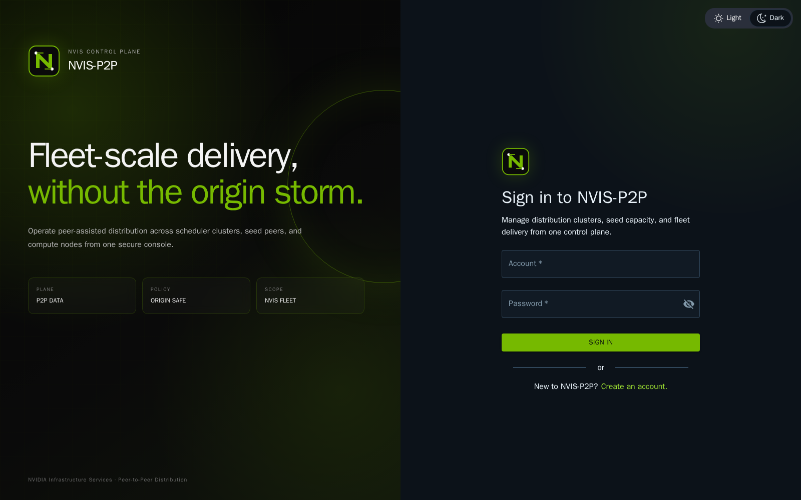
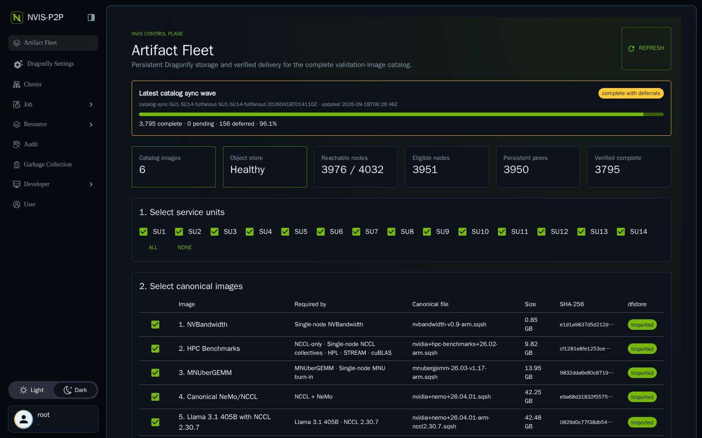
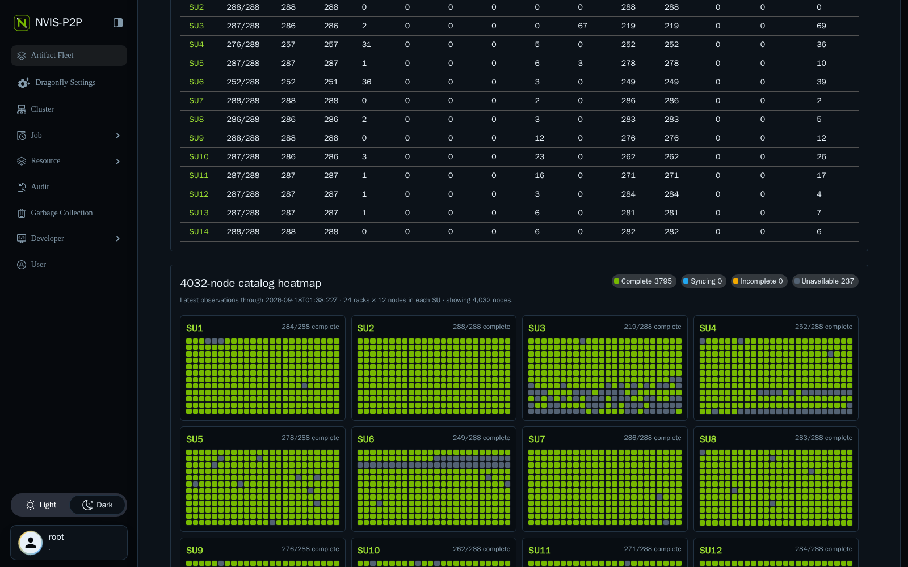
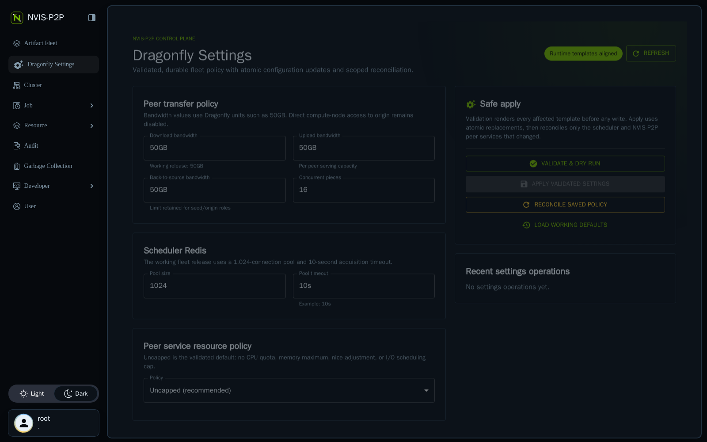

# NVIS-P2P User Guide

NVIS-P2P is the NVIS-branded artifact distribution console for maintaining the validated container catalog on compute nodes. It combines Dragonfly peer-assisted transfer with durable `dfstore` storage, per-node SHA-256 receipts, service-unit scoping, and bounded fleet operations.

This guide is for operators using the web console. Deployment, service configuration, and recovery procedures are in [DEPLOYMENT_GUIDE.md](DEPLOYMENT_GUIDE.md).

## What NVIS-P2P changes

NVIS-P2P installs three small Dragonfly client binaries (`dfdaemon`, `dfget`, and `dfstore`), configuration, two systemd units, receipts, and working directories below `/opt/containers/.nvis-p2p` on eligible compute nodes. Catalog images are materialized under `/opt/containers`.

It does not install a container engine, CUDA, GPU drivers, validation software, NHC, or a monitoring agent. Catalog synchronization does not query `journalctl`; status is read from systemd properties and `/opt/containers/.nvis-p2p/logs/catalog-sync.log`.

## Open the console

Create a tunnel from the operator workstation:

```bash
ssh -N -L 4301:192.168.10.3:4300 appserver
```

Open `http://localhost:4301`, sign in, and select **Artifact Fleet**. Artifact Fleet is restricted to the Manager root role.

On first login, open the user menu, select **Profile**, choose **Password**, and replace the vendor bootstrap password. Store the replacement in the approved secret manager. Do not expose port 4300 outside the trusted management network.



## Read the dashboard

The summary cards and status panels are observations, not assumptions:

| Item | Meaning |
|---|---|
| Catalog images | Dynamic number of required entries in `catalog/images.json`; currently six |
| Object store | Health of the durable NVIS `dfstore` backing store |
| Reachable nodes | Nodes that responded to the latest bounded preflight |
| Eligible nodes | Reachable nodes that passed architecture, page-size, identity, sudo, storage, and path checks |
| Persistent peers | Eligible nodes with a responding local `dfdaemon` socket |
| Verified complete | Nodes with every required image and a matching SHA-256 receipt |

The **Latest catalog sync wave** panel shows complete, pending, deferred, percentage, and last-update time from the latest controller run. A deferred node is not counted as success.

The **SU readiness** table shows the same state for SU1 through SU14 and includes a distribution by image count. The **4032-node catalog heatmap** always represents 14 SUs, 24 racks per SU, and 12 nodes per rack:

- Green: all catalog images verified complete.
- Blue: a catalog synchronization is active or pending for the current wave.
- Amber: reachable but incomplete, bad-sized, or present without a valid receipt.
- Gray: unavailable or excluded from the eligible roster.

Hover or keyboard-focus a square to see hostname, image counts, sync state, missing or bad images, unverified images, and observation time. Select fewer SUs to reduce the displayed heatmap without changing fleet state.





## Dragonfly Settings

The root-only **Dragonfly Settings** page manages validated fleet policy. It is not a free-form editor: every change must pass template rendering and a dry-run plan before Apply is enabled.



The page groups controls into:

- **Peer transfer policy**: download, upload, back-to-source bandwidth, and concurrent pieces. Compute-node access to origin remains disabled even though a back-to-source limit is retained for seed/origin roles.
- **Scheduler Redis**: connection-pool size and acquisition timeout.
- **Peer service resource policy**: **Uncapped (recommended)**, or explicit CPU, memory, nice, and I/O scheduling controls.

Use the controls safely:

1. Click **Refresh** and confirm the runtime-template chip says **Runtime templates aligned**. Investigate drift before changing policy.
2. Change only the intended fields.
3. Click **Validate & dry run**. Review the files changing, whether peer or scheduler reconciliation is required, eligible-node count, and preserved state.
4. Click **Apply validated settings** only after the plan is correct. Apply writes atomically and reconciles only affected NVIS-P2P components.
5. Watch the progress banner and **Recent settings operations**. Open the operation log and review every failed node.

**Reconcile saved policy** reapplies the already-saved configuration to the current eligible roster. It is disabled while the form has unsaved edits. **Load working defaults** changes only the draft; validate and apply are still required.

Settings operations preserve peer caches, receipts, artifacts, and unrelated services. Only one settings/fleet mutation may be active. Do not use resource limits as a blind response to load: establish whether hashing, storage, Redis, scheduler, seed, or fabric is the bottleneck first.

## Normal console workflow

Only one fleet operation may run at a time. While an operation is active, mutation buttons are locked. Do not start backend scripts in parallel with a console operation.

### 1. Select service units

Select one or more of SU1-SU14. **All** selects all 14; **None** clears the selection. Operations use the intersection of the selected SUs and the eligible allow-list, so excluded nodes are never silently added.

### 2. Review the canonical catalog

The image table is generated from the catalog and currently contains:

1. `nvbandwidth-v0.9-arm.sqsh` — NVBandwidth.
2. `nvidia+hpc-benchmarks+26.02-arm.sqsh` — HPC Benchmarks.
3. `mnubergemm-26.03-v1.17-arm.sqsh` — MNUberGEMM.
4. `nvidia+nemo+26.04.01.sqsh` — canonical NeMo/NCCL.
5. `nvidia+nemo+26.04.01-arm-nccl2.30.7.sqsh` — Llama 3.1 405B with NCCL 2.30.7.
6. `nvidia+nemo+26.04.01-arm.sqsh` — stock NeMo ARM for single-node and recipe validation.

The stock NeMo ARM image is an additional image. It does not replace canonical NeMo/NCCL or the Llama image. Files with equal sizes but different SHA-256 digests are not duplicates.

### 3. A. Preflight

Click **A. Preflight**, confirm the scope, and wait for `PREFLIGHT_COMPLETE` in **Recent operations → Open log**.

Review exclusions before continuing. In particular, never suppress SSH host-key checking to make a changed key pass, and do not make `/opt/containers` broadly writable. A preflight is read-only.

### 4. B. Install peers

Click **B. Install peers** after preflight. The operation installs checksum-pinned aarch64/64K client binaries and enables:

- `nvis-p2p-peer.service`, started immediately and persistent across reboot.
- `nvis-p2p-catalog-sync.service`, enabled for reboot reconciliation but not launched by initial deployment.

The deployment is rejected if the node is outside SU1-SU14, has an unexpected architecture/page size or service identity, lacks passwordless sudo, has an unwritable target, has insufficient free space, or has an active legacy `dfget` process.

Wait for `DEPLOY_COMPLETE`, inspect all `DEPLOY_DEFERRED` lines, then run Preflight again.

### 5. C. Persist selected

Select the required images and click **C. Persist selected**. Persistence imports images one at a time from `/cluster/containers` into the NVIS S3-compatible object store through `dfstore`. Each import requests 28 persistent replicas and a seven-day TTL and writes a local persistence receipt.

Completion requires one `PERSIST_READY` line per selected image. The table changes from **Not imported** to **Imported** when the receipt is present. Persistence runs on the app server; it does not write compute-node container directories.

### 6. D. Sync catalog

Click **D. Sync catalog** to materialize the complete persisted catalog on the selected eligible nodes.

The controller starts `nvis-p2p-catalog-sync.service` non-blockingly and polls with short-lived SSH requests. Native `dfstore export` performs the transfer. Existing correct files with valid receipts are skipped. Existing same-size files without receipts are hashed once; valid files receive a receipt. Bad or partial files are quarantined instead of overwritten in place.

A node completes only when the current wave observes:

```text
NVIS_P2P_SYNC_COMPLETE ... failed=0
```

The controller retries initial starts up to three times, checks unreachable nodes up to three times, bounds repeated service failures, and has a 24-hour wave timeout. `SYNC_WAVE_COMPLETE_WITH_DEFERRALS` is a partial outcome, not success. Use the run directory reported in the log:

- `complete.tsv`: nodes with explicit successful completion.
- `deferred.tsv`: nodes that exhausted a bound, with reason.
- `summary.tsv`: total, complete, deferred, and finish time.
- `sync-wave.log`: controller timeline.

### 7. E. Verify fleet

Click **E. Verify fleet** after synchronization. Verification checks each catalog filename, expected size, SHA-256 receipt, and active transfer count. Review the output TSV path in `VERIFY_COMPLETE`.

Treat these states differently:

- `verified`: expected file, size, and receipt are present.
- `present-unverified`: file and size exist, but the receipt is absent or invalid.
- `missing`: target file is absent.
- `bad-size`: target exists with a different length.
- `unreachable`: no current observation was possible.

Do not declare fleet completion from file presence or a green operation exit code alone. Use the verified count and exception list.

## Repair one image

For localized drift, select exactly one image and the affected SUs, then click **Repair selected image**. The controller uses the same allow-list, expected byte count, and digest as normal distribution. Verify afterward.

Use **Legacy single-image rollout** only when the native catalog-sync service cannot be used. It accepts exactly one image to keep fleet hashing and disk writes bounded. Repeat and verify separately for other images.

## Reboot and reprovision behavior

On a normal reboot, the enabled peer service returns first and the enabled catalog-sync service reconciles the catalog. Valid image receipts make this idempotent: already-correct content is not downloaded again.

After reprovisioning or replacement:

1. Run Preflight for the affected SU.
2. Confirm host identity and intentionally update the SSH trust record through the approved process if the machine was replaced.
3. Install peers for the affected SU.
4. Sync catalog.
5. Verify fleet and retain the exception TSV.

Never bypass a host-key change globally. Never delete `/opt/containers/.nvis-p2p/storage`, `cache`, `receipts`, or correct `.sqsh` files as a routine repair.

## Operation logs and observability

Use **Recent operations → Open log** as the primary operator record. The UI refreshes every 15 seconds. Compute-node diagnostic files are:

```text
/opt/containers/.nvis-p2p/logs/dfdaemon-service.log
/opt/containers/.nvis-p2p/logs/catalog-sync.log
/opt/containers/.nvis-p2p/receipts/<image>.sha256
```

Control-plane logs live below `/home/hlakshminara/NVIS-P2P/state`. The implementation does not poll `journalctl`. Standard platform monitoring remains authoritative for node and system-service health.

## Troubleshooting

| Symptom | What to check | Safe response |
|---|---|---|
| Object store unavailable | Object-store health and TLS endpoint | Restore the object store before Persist or Sync |
| Node unavailable | SSH error, host identity, node maintenance state | Defer; retry only after reachability is restored |
| Permission denied | Ownership and traversal of `/opt/containers` and `.nvis-p2p` | Correct the specific ownership/ACL through the approved node baseline; never `chmod 777` |
| Service missing | Preflight and install-peer operation log | Reinstall on that node/SU, then verify |
| `marker_missing` | Service became inactive without a current-wave completion line | Inspect `catalog-sync.log`; retry the bounded sync after correcting the cause |
| Present unverified | Receipt absent or digest not yet established | Run Verify or Repair; do not assume same size means same content |
| Bad size/digest | Quarantine/log detail and canonical catalog | Repair exactly that image, then verify |
| Long pending transfer | Log progress, partial-file growth, parent scheduling, seed health | Allow active progress; avoid overlapping restarts or a second wave |
| Operation buttons locked | A fleet operation is still `running` | Open its log and wait for a terminal state |

## Security rules

- Use the console through an SSH tunnel or trusted management network.
- Rotate the Manager bootstrap credential at first login.
- Keep object-store import and read-only export credentials separate and mode `0600`.
- Compute nodes receive only the read-only export credential.
- Preserve SSH host-key verification and passwordless sudo scope; investigate changes rather than suppressing them.
- Run one fleet mutation at a time and retain operation metadata and exception lists.
- Do not modify Slurm state, GPU state, NHC, validation jobs, or unrelated services as part of artifact synchronization.

## Completion checklist

- The latest Preflight represents the intended SUs.
- Object store is healthy.
- Every required catalog row is Imported.
- Latest sync wave has zero pending nodes.
- Any deferred nodes have an owner and reason.
- Verify reports every reachable eligible node complete, or records an explicit bounded deferral.
- Heatmap, SU table, operation log, and verification TSV agree.
